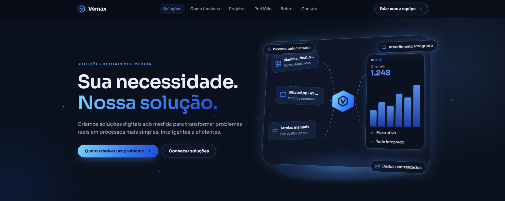
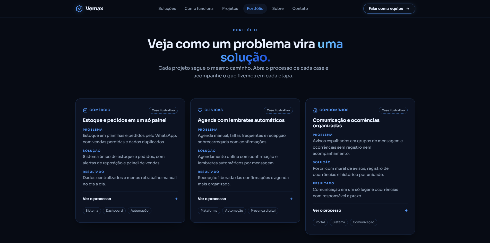
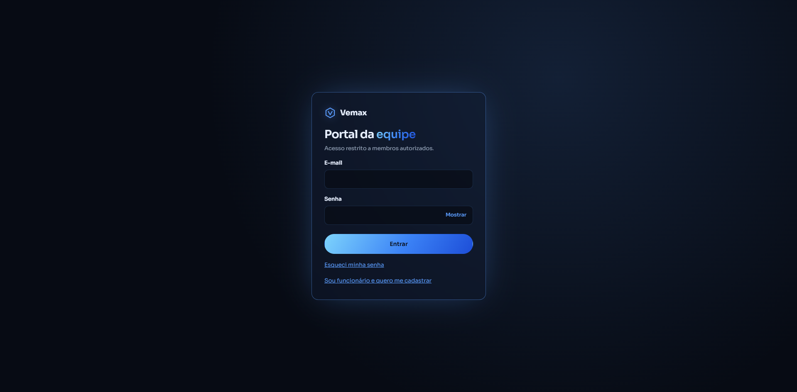
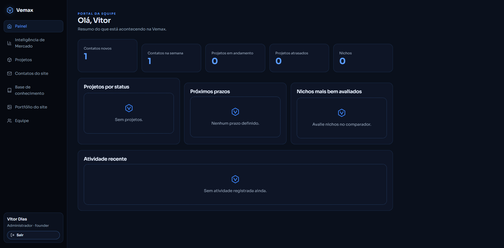
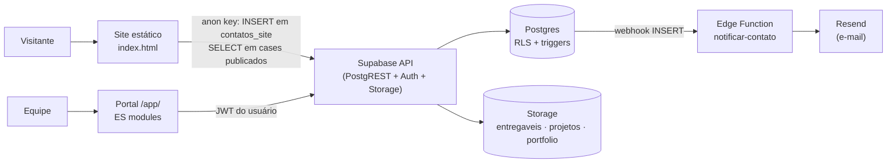
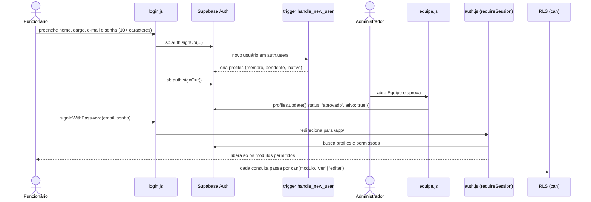

<a id="topo"></a>

<p align="center">
  
</p>

<p align="center">
  <picture>
    <source media="(prefers-color-scheme: dark)" srcset="docs/assets/banner-dark.svg">
    
  </picture>
</p>

<h1 align="center">VEMAX</h1>
<p align="center"><b>SOLUÇÕES PARA NEGÓCIOS E NECESSIDADES</b><br>
<sub>SITE INSTITUCIONAL · PORTAL INTERNO DA EQUIPE</sub></p>

<p align="center">
  <a href="https://vemax-app.kraazynino.workers.dev"></a>
  
</p>

<p align="center">
  
  
  
  
  
  
  
</p>

<p align="center">
  
  
  
  
  
  
  
</p>

A **VEMAX** é uma empresa de soluções digitais sob medida. Este repositório reúne o **site institucional** (uma página, sem build) e o **portal interno** onde a equipe acompanha contatos, projetos, base de conhecimento, pesquisa de mercado e o portfólio que aparece no site.

Projeto pessoal, sem vínculo com disciplina ou instituição. **Site no ar:** [vemax-app.kraazynino.workers.dev](https://vemax-app.kraazynino.workers.dev)

<p align="center">
  <a href="#sobre">Sobre</a> •
  <a href="#demonstracao">Demonstração</a> •
  <a href="#visao-em-camadas">Visão em camadas</a> •
  <a href="#funcionalidades">Funcionalidades</a> •
  <a href="#arquitetura">Arquitetura</a> •
  <a href="#stack">Stack</a> •
  <a href="#como-rodar">Como rodar</a> •
  <a href="#configuracao">Configuração</a> •
  <a href="#qualidade-e-seguranca">Qualidade e segurança</a> •
  <a href="#roadmap">Roadmap</a> •
  <a href="#como-contribuir">Contribuir</a> •
  <a href="#equipe">Equipe</a>
</p>

---

<a id="sobre"></a>
## 🧭 Sobre

**O problema.** Pequenos negócios costumam controlar clientes, agenda e atendimento em planilhas e WhatsApp. Muitos não sabem dizer qual sistema resolveria isso.

**Para quem é.**
- **Visitantes e clientes em potencial:** o site explica as soluções, mostra cases e leva ao contato.
- **Dono e funcionários da VEMAX:** o portal em `/app/` centraliza o trabalho da equipe.

**O que o sistema entrega.**
- Site com triagem do problema: a pessoa descreve o que acontece e recebe uma solução sugerida (`RULES` em `assets/js/script.js`, regras por palavras-chave no navegador, sem IA).
- Formulário de contato com proteção anti-spam e [política de privacidade](privacidade.html). Ele grava o lead em `contatos_site` e abre o WhatsApp ou o e-mail.
- Portfólio do site editado no portal (`portfolio_cases`) e exibido na home e em `portfolio/caso.html?c=<slug>`.
- Portal com login, cadastro aprovado pelo administrador e permissões por módulo.
- Área interna de gestão (`/app/`): leads e funil, propostas, clientes, projetos com tarefas e escopo, suporte e financeiro básico, com lixeira, auditoria e configurações editáveis. Veja [docs/AREA_INTERNA.md](docs/AREA_INTERNA.md).
- Quadro de projetos com práticas ágeis: limite de WIP, bloqueio, lead time e ciclos de 2 semanas com retrospectiva.
- Pesquisa de mercado de nichos (`research/`) com relatório, planilha e modelo para Power BI.

**Em produção:** [vemax-app.kraazynino.workers.dev](https://vemax-app.kraazynino.workers.dev) (Cloudflare Workers) · **Portal:** [/app/](https://vemax-app.kraazynino.workers.dev/app/) no mesmo domínio.

<p align="right"><a href="#topo">⬆ voltar ao topo</a></p>

<a id="demonstracao"></a>
## 🖼️ Demonstração

| Site (home) | Portfólio (home) |
|:--:|:--:|
|  |  |
| **Login e cadastro** (`/app/login/`) | **Painel do portal** (`/app/`) |
|  |  |

<p align="right"><a href="#topo">⬆ voltar ao topo</a></p>

<a id="visao-em-camadas"></a>
## 🧱 Visão em camadas

<p align="center">
  <picture>
    <source media="(prefers-color-scheme: dark)" srcset="docs/assets/arquitetura-dark.svg">
    
  </picture>
</p>

<a id="comece-por-aqui"></a>
## 📚 Comece por aqui

| Documento | Para quê |
|---|---|
| [`docs/AREA_INTERNA.md`](docs/AREA_INTERNA.md) | **Área interna atual:** o que cada módulo faz, como usar, segurança, limitações e o que fica para depois |
| [`docs/prompt-area-interna.md`](docs/prompt-area-interna.md) | Prompt original que descreve o portal: objetivo, autenticação, permissões e módulos |
| [`supabase/migrations/`](supabase/migrations/) | Esquema do banco, RLS, triggers e buckets, em ordem de `001` a `012` |
| [`research/README.md`](research/README.md) | Pesquisa de mercado: entregáveis e como regenerar |
| [`research/output/powerbi/LEIA-ME.md`](research/output/powerbi/LEIA-ME.md) | Montagem do modelo Power BI e medidas DAX |
| [`CONTRIBUTING.md`](CONTRIBUTING.md) e [`SECURITY.md`](SECURITY.md) | Fluxo de trabalho e commits; como reportar vulnerabilidade |
| [`docs/RELEASE_NOTES_v1.0.0.md`](docs/RELEASE_NOTES_v1.0.0.md) | O que a primeira versão entrega |
| [`docs/README_ANTERIOR.md`](docs/README_ANTERIOR.md) | README anterior, com o passo a passo de configuração do Supabase (cita migrations só até a 006) |

<p align="right"><a href="#topo">⬆ voltar ao topo</a></p>

<a id="funcionalidades"></a>
## ✨ Funcionalidades

| Funcionalidade | Status | Onde está no código |
|---|:--:|---|
| Site one-page (hero, soluções, processo, portfólio, contato) | ✅ entregue | `index.html`, `assets/css/styles.css`, `assets/js/script.js` |
| Triagem do problema por palavras-chave | ✅ entregue | `RULES` em `assets/js/script.js` |
| Formulário de contato (grava lead + WhatsApp/e-mail) | ✅ entregue | `assets/js/script.js`, tabela `contatos_site` |
| Anti-spam do formulário (honeypot, tempo mínimo, intervalo e teto no banco) | ✅ entregue | `spammy()` em `assets/js/script.js`, `007_contato_antispam.sql` |
| Política de privacidade do site | 🚧 modelo | `privacidade.html` (tem campos `[entre colchetes]` a preencher) |
| `robots.txt` bloqueando `/app/` | ✅ entregue | `robots.txt` |
| Portfólio dinâmico no site | ✅ entregue | `assets/js/portfolio.js`, `portfolio/caso.html`, `006_portfolio.sql` |
| Login, recuperação de senha, mostrar/ocultar senha, indicador de força | ✅ entregue | `app/js/login.js`, `app/login/index.html` |
| Cadastro com aprovação do administrador | ✅ entregue | `005_cadastro_aprovacao.sql`, `app/js/modules/equipe.js` |
| Papéis admin/membro e permissões por módulo | ✅ entregue | `001_init.sql` (`permissoes`, `can()`), `app/js/auth.js` |
| Visão geral com pendências e indicadores reais (período e responsável) | ✅ entregue | `app/js/modules/painel.js` |
| Minhas pendências (tudo que é seu, por data) e busca global (Ctrl+K) | ✅ entregue | `app/js/modules/minhas.js`, `app/js/busca.js` |
| Leads: funil em 7 etapas, quadro e lista, próxima ação, motivo de perda e origem | ✅ entregue | `app/js/modules/contatos.js`, `012_area_interna.sql` |
| Clientes: ficha, contatos, links, linha do tempo e conversão de lead sem duplicar | ✅ entregue | `app/js/modules/clientes.js` |
| Propostas: status, vencimento, aprovação e criação de projeto a partir da aprovada | ✅ entregue | `app/js/modules/propostas.js`, `projeto_de_proposta()` |
| Projetos: entregas, equipe, valor, esforço, alterações de escopo e modelos configuráveis | ✅ entregue | `app/js/modules/projetos.js`, `projeto.js` |
| Tarefas por projeto, responsável e prazo | ✅ entregue | `app/js/modules/tarefas.js` |
| Suporte: chamados com notas internas separadas de mensagens ao cliente | ✅ entregue | `app/js/modules/suporte.js` |
| Contratos recorrentes (suporte, hospedagem) com cobrança gerada automaticamente | ✅ entregue | `013_contratos_recorrentes.sql`, `app/js/modules/financeiro.js` |
| Financeiro básico: parcelas, pagamentos manuais, despesas e custo por projeto | ✅ entregue | `app/js/modules/financeiro.js` |
| Configurações (categorias, etapas, prioridades, modelos), lixeira e auditoria detalhada | ✅ entregue | `app/js/modules/configuracoes.js`, `log_mudancas()` |
| Integração com WhatsApp, e-mail recebido, calendário e bancos | 📋 planejado | não configurada; veja [docs/AREA_INTERNA.md](docs/AREA_INTERNA.md) |
| Inteligência de Mercado (pesquisas, nichos, comparador com pesos) | ✅ entregue | `app/js/modules/mercado.js`, `nichos.js`, `nicho.js`, `pesquisa.js` |
| Projetos em quadro, com anexos | ✅ entregue | `app/js/modules/projetos.js`, `004_portal_fases.sql` |
| Projetos ágil: limite de WIP, bloqueio, métricas de fluxo e ciclos com retrospectiva | ✅ entregue | `projetos.js` (`openWip`, `openCiclos`, `drawStats`), `008_agil.sql` |
| Base de conhecimento | ✅ entregue | `app/js/modules/conhecimento.js` |
| Gestão do portfólio (imagem, antes/depois, etapas, depoimento) | ✅ entregue | `app/js/modules/portfolio.js` |
| Log de atividades | ✅ entregue | `log_atividade()` e triggers `t_log_*` em `001_init.sql` |
| E-mail ao chegar contato novo | 🚧 código pronto | `supabase/functions/notificar-contato/index.ts` (precisa ser implantada no Supabase) |
| Relatório, planilha e pacote Power BI de nichos | ✅ entregue | `research/` (o `.pbix` não foi gerado) |
| Verificação de links dos `.md` e dos SVGs (GitHub Actions) | ✅ entregue | `.github/workflows/qualidade.yml` |
| Testes automatizados das regras de negócio e verificação estática | ✅ entregue | `tests/`, `scripts/verificar.mjs`, `.github/workflows/testes.yml` |
| Dados de contato do site (WhatsApp, e-mail, cidade, Instagram) | ✅ entregue | `assets/js/config.js`, rodapé do `index.html` |

<p align="right"><a href="#topo">⬆ voltar ao topo</a></p>

<a id="arquitetura"></a>
## 🏗️ Arquitetura

**Padrão:** front-end estático que fala direto com o Supabase. Não há servidor próprio. A escolha mantém o custo e a manutenção baixos: não há build, e qualquer hospedagem estática serve. Como o navegador chama o banco, **a segurança fica na RLS** do Postgres. As checagens em JavaScript existem só para a interface.



**Fluxo mais importante: cadastro com aprovação e entrada no portal**



> [!NOTE]
> O primeiro usuário com e-mail confirmado vira **administrador**. Os seguintes entram como membro, pendentes e inativos (`005_cadastro_aprovacao.sql`).

<p align="right"><a href="#topo">⬆ voltar ao topo</a></p>

<a id="estrutura-do-repositorio"></a>
## 🗂️ Estrutura do repositório

```text
.
├── index.html              # site institucional (one-page)
├── privacidade.html        # política de privacidade (modelo a preencher)
├── robots.txt              # libera o site e bloqueia /app/
├── assets/
│   ├── css/styles.css      # estilos do site
│   └── js/                 # config.js (contato/Supabase), script.js, portfolio.js
├── portfolio/caso.html     # página de um case (?c=<slug>)
├── shared/tokens.css       # design tokens usados pelo site e pelo portal
├── app/                    # portal interno
│   ├── login/              # login, cadastro e redefinição de senha
│   ├── contatos/ propostas/ clientes/ projetos/ tarefas/ suporte/ financeiro/   # operação
│   ├── mercado/ conhecimento/ portfolio/ equipe/ configuracoes/
│   │   (clientes/ficha.html e projetos/detalhe.html são as fichas)
│   ├── css/app.css
│   └── js/                 # auth.js, supabase.js, ui.js, core.js, lib.js, login.js, config.js, modules/
├── supabase/
│   ├── migrations/         # 001 a 013: tabelas, RLS, triggers, buckets, anti-spam, ágil, área interna, contratos
│   └── functions/notificar-contato/   # Edge Function (Deno)
├── research/               # pesquisa de mercado (scripts Node + relatório, planilha, CSVs)
├── tests/  scripts/        # testes unitários (npm test) e verificação estática (npm run check)
├── docs/                   # AREA_INTERNA.md, prompt do portal, notas da release, README anterior e imagens (assets/)
├── .github/                # workflow de qualidade, templates de issue e PR, CODEOWNERS
└── CONTRIBUTING.md  SECURITY.md
```

<a id="componentes-principais"></a>
## 🧩 Componentes principais

- **Site (`assets/js/script.js`)**: triagem do problema (`RULES`), formulário de contato com `fetch` para `/rest/v1/contatos_site` (sem bloquear o envio ao WhatsApp/e-mail se falhar) e a seção de negócios.
- **Anti-spam (`spammy()` em `script.js`)**: descarta a gravação do lead se o campo isca `#cSite` vier preenchido, se o envio ocorrer menos de 3 s após abrir o formulário ou se houver outro envio na mesma sessão em menos de 60 s (`sessionStorage`). O contato ao WhatsApp ou e-mail não é afetado.
- **Privacidade (`privacidade.html`)**: descreve só o que o site faz hoje (formulário gravado no portal). Está como modelo, com `[data]`, `[razão social]`, `[prazo]` e outros campos a preencher.
- **Portfólio do site (`assets/js/portfolio.js`)**: lê `portfolio_cases` publicados. Sem nenhum publicado, mostra 3 exemplos ilustrativos com selo. Os contadores só consideram cases publicados e não ilustrativos.
- **Sessão e permissões (`app/js/auth.js`)**: `requireSession()` redireciona sem sessão, bloqueia perfil inativo (`pendente`, `recusado` ou `inativo`) e expõe `can(modulo, acao)`.
- **Cliente Supabase (`app/js/supabase.js`)**: `createClient` com sessão persistente e renovação automática do token.
- **Interface (`app/js/ui.js`)**: `start()` monta a barra lateral conforme as permissões, mostra o selo de cadastros pendentes ao admin e traz modais, formulários e `run()` (mensagem amigável para erro `42501`).
- **Login (`app/js/login.js`)**: erro genérico "E-mail ou senha incorretos.", mínimo de 10 caracteres, redefinição de senha por e-mail e tratamento dos códigos `signup_disabled` e `over_email_send_rate_limit`.
- **Módulos (`app/js/modules/`)**: `painel`, `contatos` (leads), `propostas`, `clientes`, `projetos`, `projeto`, `tarefas`, `suporte`, `financeiro`, `configuracoes`, `equipe`, `acompanhamento` (link do cliente), `mercado`, `nichos`, `nicho`, `pesquisa`, `conhecimento`, `portfolio`.
- **Regras e peças compartilhadas**: `app/js/lib.js` (regras puras, testadas) e `app/js/core.js` (tabela ordenável e paginada, Kanban, linha do tempo, lixeira, filtros).
- **Projetos ágil (`app/js/modules/projetos.js`)**:
  - Limite de WIP por coluna (`openWip`, tabela `projeto_wip`): a coluna fica destacada acima do limite. É só um aviso, não bloqueia.
  - Bloqueio com motivo (`block()`, campos `bloqueado` e `motivo_bloqueio`).
  - Métricas dos últimos 30 dias (`drawStats`): em andamento, bloqueados, entregues, lead time médio e entregas por semana.
  - Ciclos de 2 semanas com retrospectiva (`openCiclos`, tabela `projeto_ciclos`).
  - Se a migration 008 ainda não foi aplicada, a página continua funcionando, sem ciclos nem limites.
- **Banco (`supabase/migrations/`)**:
  - `001_init.sql`: `profiles`, `permissoes`, `atividades`, `nichos`, `pesquisas`, `concorrentes`, `fontes`, `criterios`, `notas_nicho`, `anexos`, `modelos_prompt`, `projetos`, `contatos_site`, `conhecimento`, helpers `is_admin()`, `is_active()`, `my_papel()`, `can()` e bucket `entregaveis`.
  - `002` e `003`: endurecem `handle_new_user()` e revogam `EXECUTE` das funções internas para `anon`.
  - `004`: fase 2 (responsável e notas em contatos, anexos de projeto, bucket `projetos`).
  - `005`: cadastro com aprovação (`profiles.status`).
  - `006`: `portfolio_cases` e bucket público `portfolio` (5 MB, PNG/JPEG/WebP).
  - `007`: trigger `limitar_contatos()`, que barra inserções públicas em `contatos_site`: no máximo 3 por contato e 60 no total, por hora.
  - `008`: `projeto_ciclos`, `projeto_wip`, colunas de bloqueio e de datas de fluxo em `projetos`, e o trigger `projetos_datas()`, que preenche `iniciado_em` e `concluido_em` conforme o status.
  - `009` a `011`: perfil do diagnóstico, funil e propostas online, notificações, acompanhamento e avaliação do cliente.
  - `013`: `contratos` e a função `gerar_cobrancas_recorrentes()`, que cria as cobranças de cada período sem duplicar.
  - `012`: `clientes`, `tarefas`, `chamados`, `cobrancas`, `despesas`, `interacoes` (linha do tempo), `opcoes`/`categorias_servico`/`modelos_projeto` (configurações), novas etapas e colunas em leads, propostas e projetos, exclusão recuperável (`deleted_at`), auditoria `log_mudancas()` e as funções `projeto_de_proposta()`, `aplicar_modelo_projeto()` e `atualizar_vencimentos()`.
- **Edge Function (`supabase/functions/notificar-contato/index.ts`)**: valida o header `x-webhook-secret`, escapa o HTML e envia o aviso pelo Resend.
- **Pesquisa (`research/scripts/`)**: `data.js` guarda fatos, notas e fontes. `build.js` gera PDF, XLSX e CSVs. `charts.js` desenha os gráficos.

<p align="right"><a href="#topo">⬆ voltar ao topo</a></p>

<a id="stack"></a>
## 🛠️ Stack

| Camada | Tecnologia | Versão | Para quê |
|---|---|---|---|
| Site e portal | HTML, CSS e JavaScript (ES modules) | sem build | Páginas estáticas, sem framework |
| Tipografia | Sora (Google Fonts) | 400–700 | Fonte do site e do portal |
| Cliente do banco | `@supabase/supabase-js` via jsDelivr | `@2` | Auth, consultas e Storage no navegador |
| Backend | Supabase (Auth, Postgres, Storage) | gerenciado | Dados, login, RLS e arquivos |
| Função de borda | Deno (Supabase Edge Functions) | — | Aviso por e-mail de contato novo |
| E-mail | Resend | API | Envio da notificação |
| Pesquisa | Node.js + `exceljs` | `^4.4.0` | Gera planilha, relatório e CSVs |
| PDF dos relatórios | Microsoft Edge ou Chrome instalado | — | Impressão do PDF e imagens dos gráficos |

<p align="right"><a href="#topo">⬆ voltar ao topo</a></p>

<a id="como-rodar"></a>
## 🚀 Como rodar

**Pré-requisitos**
- Node.js (versão LTS), só para o `npx serve` e para a pesquisa de mercado.
- Uma conta no [Supabase](https://supabase.com) para o portal. O site funciona sem ela.

Não há build. Módulos ES não funcionam via `file://`, então sirva a pasta com um servidor estático.

**Windows (PowerShell)**
```powershell
cd vemax-app
npx serve .
```

**Linux / macOS**
```bash
cd vemax-app
npx serve .
```

Site: `http://localhost:3000/` · Portal: `http://localhost:3000/app/`

Testes (Node 20+, sem instalar nada): `npm test` e `npm run check`.

> [!NOTE]
> Se a porta 3000 estiver ocupada, o `serve` escolhe outra e mostra no terminal.

### Configurar o portal (Supabase)

1. Crie um projeto no Supabase.
2. Em **Authentication → Providers → Email**, mantenha *Allow new users to sign up* ativado e *Confirm email* ligado.
3. No **SQL Editor**, execute em ordem `supabase/migrations/001_init.sql` até `013_contratos_recorrentes.sql`.
4. Em **Project Settings → API**, copie a *Project URL* e a chave *anon/publishable* para `app/js/config.js`.
5. Em **Authentication → Users → Add user**, crie o seu usuário. **O primeiro usuário vira administrador.**
6. Entre em `/app/` e ajuste cargos e permissões em **Equipe**.
7. Opcional: preencha `supabaseUrl` e `supabaseAnonKey` em `assets/js/config.js` para gravar os contatos do site no portal.

> [!IMPORTANT]
> Use só a chave **anon/publishable** no front-end. A `service_role` nunca vai em arquivo do repositório.

<details>
<summary><b>Comandos avançados: pesquisa de mercado e Edge Function</b></summary>

**Regenerar relatório, planilha e CSVs** (precisa de Edge ou Chrome instalado):

```powershell
cd research/scripts
npm install
node build.js
```

**Edge Function `notificar-contato`:**
1. Defina os secrets `RESEND_API_KEY`, `NOTIFY_TO` (e-mails separados por vírgula), `NOTIFY_FROM` e `WEBHOOK_SECRET`.
2. Faça o deploy da função no Supabase.
3. Em **Database → Webhooks**, crie um webhook na tabela `contatos_site`, evento `INSERT`, com o header `x-webhook-secret: <WEBHOOK_SECRET>`.

**Edge Function `notificar-email` (recomendada; substitui a `notificar-contato`):**
Envia por e-mail tudo o que aparece no sino do portal: lead novo, proposta aceita ou recusada, avaliação recebida e cadastro pendente.
1. Aplique a migration `011_notificacoes_cliente.sql` (cria a tabela `notificacoes`).
2. Defina os secrets `RESEND_API_KEY`, `NOTIFY_TO`, `NOTIFY_FROM` e `WEBHOOK_SECRET` (os mesmos da função anterior) e, opcionalmente, `SITE_URL` para incluir o link do portal no e-mail.
3. Publique sem verificação de JWT, porque quem chama é o webhook: `supabase functions deploy notificar-email --no-verify-jwt`.
4. Em **Database → Webhooks**, crie um webhook na tabela **`notificacoes`**, evento `INSERT`, método `POST`, URL da função e o header `x-webhook-secret: <WEBHOOK_SECRET>`.
5. Remova o webhook de `contatos_site` para não receber o aviso de lead duas vezes.
6. Com o domínio do Resend ainda não verificado, o Resend só entrega para o e-mail da sua própria conta; use `NOTIFY_FROM="Vemax <onboarding@resend.dev>"` e `NOTIFY_TO` com esse e-mail para testar.

</details>

<p align="right"><a href="#topo">⬆ voltar ao topo</a></p>

<a id="configuracao"></a>
## ⚙️ Configuração

Não há `.env`. A configuração fica em arquivos JavaScript públicos e em secrets da Edge Function.

| Onde | Chave | Obrigatória | Descrição | Exemplo seguro |
|---|---|:--:|---|---|
| `app/js/config.js` | `SUPABASE_URL` | Para o portal | URL do projeto Supabase | `https://SEU-PROJETO.supabase.co` |
| `app/js/config.js` | `SUPABASE_ANON_KEY` | Para o portal | Chave pública anon/publishable | `<chave-anon-do-seu-projeto>` |
| `assets/js/config.js` | `whatsapp` | Recomendada | DDI + DDD + número, só dígitos | `55119XXXXXXXX` |
| `assets/js/config.js` | `email` | Recomendada | E-mail do formulário de contato | `contato@seudominio.com.br` |
| `assets/js/config.js` | `supabaseUrl` / `supabaseAnonKey` | Opcional | Gravar contatos e ler o portfólio publicado | mesmos valores do portal |
| Secrets da função | `RESEND_API_KEY` | Se usar a função | Chave da API do Resend | `<segredo>` |
| Secrets da função | `NOTIFY_TO` | Se usar a função | Destinatários, separados por vírgula | `equipe@seudominio.com.br` |
| Secrets da função | `NOTIFY_FROM` | Se usar a função | Remetente do aviso | `Vemax <avisos@seudominio.com.br>` |
| Secrets da função | `WEBHOOK_SECRET` | Se usar a função | Segredo comparado com o header `x-webhook-secret` | `<segredo-longo-e-aleatorio>` |

> [!WARNING]
> Os dois `config.js` contêm só valores **públicos**. Nunca coloque neles a `service_role`, a chave do Resend ou o `WEBHOOK_SECRET`. Esses três ficam apenas nos secrets do Supabase.

> [!TIP]
> A política do banco só deixa o visitante **inserir** contatos com status `novo`. A leitura exige login e permissão no módulo `contatos`.

<p align="right"><a href="#topo">⬆ voltar ao topo</a></p>

<a id="qualidade-e-seguranca"></a>
## 🔒 Qualidade e segurança

**Testes e CI:** `npm test` roda os testes unitários das regras de negócio (`tests/`) e `npm run check` faz a verificação estática (sintaxe, imports, páginas, menu, sequência de migrations); o workflow `Testes` (`.github/workflows/testes.yml`) executa os dois quando código, testes ou migrations mudam. As telas e o SQL foram exercitados com um banco e um Supabase simulados (veja [docs/AREA_INTERNA.md](docs/AREA_INTERNA.md)); falta testar no projeto Supabase real. O workflow `Qualidade` (`.github/workflows/qualidade.yml`) roda em push e Pull Request na `main` e verifica os links dos `.md` e se os SVGs de `docs/assets` são XML válido. Ele só dispara quando `.md`, `docs/assets/` ou o próprio workflow mudam, para gastar poucos minutos do Actions. Sem segredos e sem deploy. O resto da verificação é manual.

**O que protege o sistema de verdade:**
- RLS ativa nas tabelas, com política padrão de negar. As permissões por módulo vivem na tabela `permissoes` e são avaliadas por `can()`.
- Funções internas (`handle_new_user`, `log_atividade`, `limitar_contatos`, `projetos_datas`) sem `EXECUTE` para `anon` (`003`, `007` e `008`).
- Anti-spam em duas camadas: no navegador (`spammy()`) e no banco (`limitar_contatos()`, 3 por contato e 60 no total, por hora). O navegador é contornável, por isso o teto fica no banco.
- `robots.txt` pede aos buscadores que não indexem `/app/`. Isso não substitui o login.
- `privacidade.html` é um modelo. Preencha os campos e peça revisão jurídica antes de publicar.
- Bucket `entregaveis` privado, com download por URL assinada de 2 minutos. Bucket `projetos` privado. Bucket `portfolio` público, só para imagens de até 5 MB.
- Usuário comum não consegue alterar o próprio papel, status ou e-mail (`profiles_self`, `005`).
- Triggers `t_log_*` registram criação, lixeira, restauração e a mudança (de → para) de status, valores, prazos, papéis e permissões na tabela `atividades`; cada pessoa só lê o log dos módulos a que tem acesso.
- Registros de negócio vão para a lixeira (`deleted_at`); só administradores excluem de vez.
- Mensagem de login genérica e senha com 10 caracteres no mínimo.

> [!IMPORTANT]
> A checagem de permissão no JavaScript é só conveniência de interface. A barreira real é a RLS no banco.

<p align="right"><a href="#topo">⬆ voltar ao topo</a></p>

<a id="deploy"></a>
## 📦 Deploy

O site e o portal estão publicados no **Cloudflare Workers**, em [vemax-app.kraazynino.workers.dev](https://vemax-app.kraazynino.workers.dev). Como são arquivos estáticos, qualquer hospedagem estática serve, publicando a raiz do repositório. O banco, o login e os arquivos ficam no projeto Supabase, criado pelo passo a passo de [Como rodar](#como-rodar). A Edge Function, se for usada, é implantada à parte no Supabase, com um webhook na tabela `contatos_site`.

> [!NOTE]
> O repositório não tem `wrangler.toml` nem `wrangler.jsonc`: a configuração do Cloudflare Workers não está versionada aqui.


<a id="roadmap"></a>
## 🗺️ Roadmap

O repositório não tem issues nem TODOs no código. Os itens abaixo vêm do que o próprio projeto declara como pendente.

- [ ] Preencher a política de privacidade (`[data]`, `[razão social]`, CNPJ, prazo de retenção) e pedir revisão jurídica.
- [ ] Quando o domínio estiver definido, adicionar o `Sitemap:` ao `robots.txt`.
- [ ] Aplicar as migrations `006` a `012` no Supabase e definir as permissões do papel Membro (veja `to-do/PENDENCIAS.md`).
- [ ] Implantar a Edge Function `notificar-email` no Supabase e criar o webhook.
- [ ] Etapa posterior da área interna: WhatsApp/e-mail/calendário oficiais, portal do cliente, assinatura eletrônica, integrações bancárias e fiscais, apontamento de horas, relatórios para BI (veja [docs/AREA_INTERNA.md](docs/AREA_INTERNA.md)).
- [ ] Cadastrar os primeiros cases reais no portal (hoje o site mostra 3 exemplos ilustrativos).
- [ ] Gerar o arquivo `.pbix` do Power BI (hoje só há o modelo de dados em CSV).

<p align="right"><a href="#topo">⬆ voltar ao topo</a></p>

<a id="como-contribuir"></a>
## 🤝 Como contribuir

1. Antes de começar, atualize a `main`: `git switch main && git pull`.
2. Crie uma branch: `feature/nome-curto` ou `fix/nome-curto`.
3. Faça mudanças pequenas e teste com `npx serve .`.
4. Faça commits no padrão [Conventional Commits](https://www.conventionalcommits.org/pt-br/) (`feat`, `fix`, `docs`, `chore`, `style`, `refactor`, `test`).
5. Abra um Pull Request para a `main`. O [template](.github/pull_request_template.md) pede o que mudou, por quê e como testar.

Guias completos: [CONTRIBUTING.md](CONTRIBUTING.md) e [SECURITY.md](SECURITY.md) (como reportar uma vulnerabilidade de forma privada).

Exemplos do histórico do repositório:

```text
feat(portfolio): implement portfolio management module with CRUD functionality
feat: enhance signup error handling with detailed messages and console diagnostics
feat: update theme colors and design tokens for improved UI consistency
feat: paleta fria, portfólio dinâmico, anti-spam, privacidade e práticas ágeis em Projetos
```

> [!NOTE]
> Mudanças no banco entram como uma nova migration numerada (`013_...sql`). Não edite as migrations já executadas.

<p align="right"><a href="#topo">⬆ voltar ao topo</a></p>

<a id="equipe"></a>
## 👥 Equipe

| Avatar | Nome | GitHub | Papel |
|:--:|---|---|---|
|  | Vitor Dias Santana | [@vitin2505](https://github.com/vitin2505) | Fundador |
|  | Marcos Vinicius | [@markiimm](https://github.com/markiimm) | Fundador |

<a id="entregas"></a>
## 🏁 Entregas

- **Site:** [vemax-app.kraazynino.workers.dev](https://vemax-app.kraazynino.workers.dev)
- **Código:** [github.com/Vemax-tech/vemax-app](https://github.com/Vemax-tech/vemax-app)
- **Commits:** [histórico completo](https://github.com/Vemax-tech/vemax-app/commits/main)
- **Versão:** `v1.0.0`. Notas em [docs/RELEASE_NOTES_v1.0.0.md](docs/RELEASE_NOTES_v1.0.0.md).

<a id="licenca"></a>
## 📄 Licença

© 2026 VEMAX. Todos os direitos reservados. Este código é público para fins de portfólio; uso, cópia ou distribuição dependem de autorização da equipe.

---

<p align="center">Feito com 💙 pela equipe VEMAX · 2026</p>
<p align="center"><a href="#topo">⬆ voltar ao topo</a></p>
