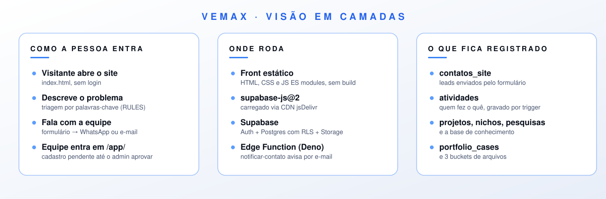

<a id="topo"></a>

<p align="center">
  <picture>
    <source media="(prefers-color-scheme: dark)" srcset="docs/assets/banner-dark.svg">
    
  </picture>
</p>

<p align="center"><b>SOLUÇÕES PARA NEGÓCIOS E NECESSIDADES</b><br>
<sub>SITE INSTITUCIONAL · PORTAL INTERNO DA EQUIPE</sub></p>

<p align="center">
  <a href="https://vemax-app.kraazynino.workers.dev"></a>
  
  
</p>

<p align="center">
  
  
  
  
  
</p>

<p align="center">
  
  
  
  
</p>

A **VEMAX** faz soluções digitais sob medida para pequenos negócios. Este repositório reúne o **site institucional**, que explica as soluções e leva ao contato, e o **portal interno** (`/app/`), onde a equipe cuida de leads, propostas, clientes, projetos, suporte e financeiro. Está no ar em [vemax-app.kraazynino.workers.dev](https://vemax-app.kraazynino.workers.dev).

<p align="center">
  <picture>
    <source media="(prefers-color-scheme: dark)" srcset="docs/assets/arquitetura-dark.svg">
    
  </picture>
</p>

## 📚 Comece por aqui

| Documento | Para quê |
|---|---|
| [docs/CONFIGURACAO.md](docs/CONFIGURACAO.md) | **rodar localmente, montar o Supabase, chaves, e-mail e deploy** |
| [docs/ARQUITETURA.md](docs/ARQUITETURA.md) | diagramas, pastas, componentes e o que cada migration faz |
| [docs/AREA_INTERNA.md](docs/AREA_INTERNA.md) | o portal no dia a dia: o que cada módulo faz e como usar |
| [docs/SEGURANCA.md](docs/SEGURANCA.md) | auditoria de segurança, testes e riscos que restam |
| [docs/PENDENCIAS.md](docs/PENDENCIAS.md) | o que ainda depende do painel do Supabase ou de decisão da equipe |
| [CONTRIBUTING.md](CONTRIBUTING.md) · [SECURITY.md](SECURITY.md) | fluxo de trabalho e commits · como reportar uma vulnerabilidade |

## 🎯 O que o sistema faz

**Site** (`public/`)
- Página única com soluções, processo, portfólio e contato, e uma triagem do problema por palavras-chave (sem IA).
- Formulário de contato com anti-spam no navegador e no banco. O lead vai para o portal e a conversa segue no WhatsApp ou no e-mail.
- Portfólio editado no portal e publicado na home e em `portfolio/caso.html?c=<slug>`.
- Links privados para o cliente: proposta online, acompanhamento do projeto e avaliação pós-entrega.

**Portal** (`public/app/`)
- Login com cadastro aprovado pelo administrador, permissões por módulo e 2FA.
- Visão geral, minhas pendências e busca global (Ctrl+K).
- Leads em funil, propostas, clientes com linha do tempo, projetos com tarefas e práticas ágeis, suporte e financeiro com contratos recorrentes.
- Inteligência de mercado, base de conhecimento, portfólio do site, lixeira e auditoria de mudanças.

## 🖼️ Telas

| Site (home) | Portfólio (home) |
|:--:|:--:|
|  |  |
| **Login e cadastro** (`/app/login/`) | **Painel do portal** (`/app/`) |
|  |  |

## 📁 Estrutura do repositório

```text
.
├── public/               # tudo o que vai ao ar: site, portal (app/), CSS/JS compartilhados e _headers
├── supabase/             # migrations 001 a 014 (tabelas, RLS, triggers) e a Edge Function notificar-email
├── tests/                # testes unitários e de integração (Postgres em memória e telas simuladas)
├── scripts/              # verificação estática (npm run check)
├── research/             # pesquisa de mercado de nichos: scripts e entregáveis
├── docs/                 # documentação e imagens do README
├── .github/              # CI, Dependabot, templates de issue e PR, CODEOWNERS
├── wrangler.jsonc        # deploy no Cloudflare Workers (publica só public/)
└── package.json          # scripts de teste e verificação (o site não tem dependências)
```

O detalhe de cada pasta e arquivo está em [docs/ARQUITETURA.md](docs/ARQUITETURA.md#estrutura-de-pastas).

## 🧰 Stack

HTML, CSS e JavaScript com ES modules, **sem framework e sem build**. Supabase (Auth, Postgres com RLS e Storage) com `supabase-js` em versão fixa. Edge Function em Deno com e-mail pelo Resend. Hospedagem estática no Cloudflare Workers. Testes com `node:test`, PGlite e jsdom. A pesquisa de mercado usa Node.js e `exceljs`.

A segurança fica no banco: como o navegador fala direto com o Supabase, cada consulta passa pela RLS do Postgres. As checagens em JavaScript existem só para a interface.

## 🚀 Como rodar

Precisa de Node.js 22 ou mais novo.

```bash
npm run dev
```

Site em `http://localhost:3000/` e portal em `http://localhost:3000/app/`. Para o portal funcionar, configure um projeto Supabase seguindo [docs/CONFIGURACAO.md](docs/CONFIGURACAO.md#configurar-o-portal-supabase).

```bash
npm run check
```

```bash
npm test
```

## ✅ Qualidade

| Workflow | Quando roda | O que faz |
|---|---|---|
| [CI](.github/workflows/ci.yml) | push e PR com mudança de código | verificação estática, testes unitários e integração (migrations num Postgres real em memória, RLS, injeção de SQL, telas, login e sessão) |
| [Documentação](.github/workflows/docs.yml) | push e PR com mudança em `.md` ou `docs/` | links quebrados nos `.md` e SVGs válidos |
| [Segredos](.github/workflows/segredos.yml) | push, PR e toda segunda-feira | TruffleHog em todo o histórico do Git |

O Dependabot abre PR quando as Actions ou as dependências de teste e da pesquisa têm versão nova.

## 👥 Equipe

| Avatar | Nome | GitHub | Papel |
|:--:|---|---|---|
|  | Vitor Dias Santana | [@vitin2505](https://github.com/vitin2505) | Fundador |
|  | Marcos Vinicius | [@markiimm](https://github.com/markiimm) | Fundador |

## 📄 Licença

© 2026 VEMAX. Todos os direitos reservados. Uso, cópia ou distribuição dependem de autorização prévia e por escrito (ver [LICENSE](LICENSE)).

<p align="right"><a href="#topo">⬆ voltar ao topo</a></p>
