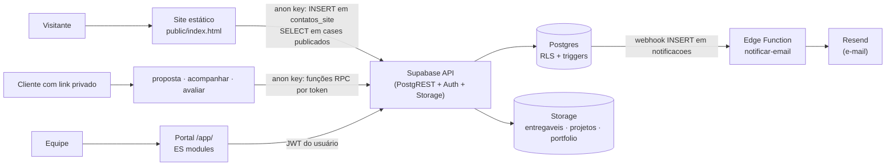
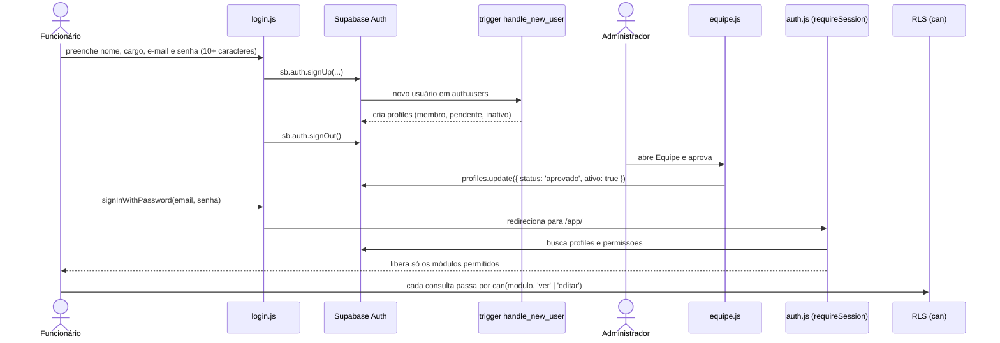

# Arquitetura

Como o site e o portal da VEMAX são montados, onde fica cada peça e o que cada migration do banco faz.

## Padrão

Front-end estático que fala direto com o Supabase. **Não há servidor próprio nem build.** Tudo o que vai ao ar fica em `public/` e é servido como arquivo estático pelo Cloudflare Workers.

A escolha mantém custo e manutenção baixos, mas tem uma consequência importante: como o navegador chama o banco, **a segurança fica na RLS do Postgres**. As checagens de permissão em JavaScript existem só para a interface.



## Fluxo principal: cadastro com aprovação e entrada no portal



O primeiro usuário com e-mail confirmado vira **administrador**. Os seguintes entram como membro, pendentes e inativos (`005_cadastro_aprovacao.sql`).

## Estrutura de pastas

```text
public/                       # tudo o que vai ao ar (assets do Cloudflare Workers)
├── index.html                # site institucional (one-page)
├── privacidade.html          # política de privacidade (modelo a preencher)
├── proposta.html             # proposta online, por link privado (token)
├── acompanhar.html           # acompanhamento do projeto pelo cliente (token)
├── avaliar.html              # avaliação pós-entrega (token)
├── portfolio/caso.html       # página de um case (?c=<slug>)
├── robots.txt                # libera o site e bloqueia /app/
├── _headers                  # CSP e cabeçalhos de segurança do Cloudflare
├── assets/
│   ├── css/styles.css        # estilos do site
│   └── js/                   # script.js, valida.js, portfolio.js, proposta.js, acompanhar.js, avaliar.js, config.js…
├── shared/
│   ├── tokens.css            # design tokens do site e do portal
│   └── js/                   # dom.js, tabela.js, formato.js, validacao.js, sessao.js
└── app/                      # portal interno
    ├── index.html            # visão geral
    ├── login/ minhas/ contatos/ propostas/ clientes/ projetos/ tarefas/
    ├── suporte/ financeiro/ mercado/ conhecimento/ portfolio/ equipe/ configuracoes/
    ├── css/app.css
    └── js/                   # boot.js, auth.js, supabase.js, ui.js, core.js, lib.js, busca.js, notifs.js, login.js, config.js
        └── modules/          # uma tela por arquivo

supabase/
├── migrations/               # 001 a 014, aplicadas em ordem
└── functions/notificar-email/  # Edge Function (Deno)

tests/                        # unitários (npm test) e integration/ (PGlite + jsdom)
scripts/verificar.mjs         # verificação estática (npm run check)
research/                     # pesquisa de mercado: scripts Node e entregáveis (PDF, XLSX, CSV para Power BI)
docs/                         # esta documentação e as imagens do README (assets/)
```

## Componentes principais

**Site (`public/assets/js/`)**
- `script.js`: triagem do problema por palavras-chave (`RULES`, sem IA), diagnóstico guiado e formulário de contato. Grava o lead em `contatos_site` sem bloquear o envio ao WhatsApp ou e-mail se a gravação falhar.
- Anti-spam (`spammy()`): descarta a gravação se o campo isca vier preenchido, se o envio ocorrer menos de 3 s após abrir o formulário ou se houver outro envio na mesma sessão em menos de 60 s. O teto real fica no banco (`limitar_contatos()`).
- `valida.js`: mesma validação de contato de `shared/js/validacao.js` (um teste garante que as duas dão o mesmo resultado).
- `portfolio.js`: lê `portfolio_cases` publicados. Sem nenhum publicado, mostra 3 exemplos marcados como ilustrativos.
- `proposta.js`, `acompanhar.js`, `avaliar.js`: páginas de link privado, que só falam com funções RPC que devolvem campos seguros.

**Portal (`public/app/js/`)**
- `boot.js`: ponto de entrada de cada página (lê `data-modulo` e `data-fn`), para não haver script embutido.
- `auth.js`: `requireSession()` redireciona sem sessão, bloqueia perfil inativo e expõe `can(modulo, acao)`.
- `supabase.js`: cliente `supabase-js` com versão exata, sessão persistente e renovação automática do token.
- `ui.js`: barra lateral conforme as permissões, modais, formulários e `run()` (mensagem amigável para erros do banco).
- `lib.js`: regras puras (datas, dinheiro, parcelas, status calculados, alertas). `core.js`: tabela, Kanban, linha do tempo, lixeira.
- `busca.js` (Ctrl+K) e `notifs.js` (sino de notificações).
- `modules/`: `painel`, `minhas`, `contatos` (leads), `propostas`, `clientes`, `projetos`, `projeto`, `tarefas`, `suporte`, `financeiro`, `configuracoes`, `seguranca`, `equipe`, `acompanhamento`, `mercado`, `nichos`, `nicho`, `pesquisa`, `conhecimento`, `portfolio`.

**Compartilhado (`public/shared/js/`)**: o que não é de uma área só. `dom.js` (DOM seguro, modal, toast), `tabela.js` (tabela ordenável, Kanban, filtros, CSV), `formato.js`, `validacao.js` e `sessao.js` (saída por inatividade).

O uso de cada módulo no dia a dia está em [AREA_INTERNA.md](AREA_INTERNA.md).

## Banco de dados (`supabase/migrations/`)

| Migration | O que faz |
|---|---|
| `001_init.sql` | `profiles`, `permissoes`, `atividades`, nichos e pesquisas, `projetos`, `contatos_site`, `conhecimento`; helpers `is_admin()`, `is_active()`, `my_papel()`, `can()`; bucket `entregaveis` |
| `002`, `003` | Endurecem `handle_new_user()` e revogam `EXECUTE` das funções internas para `anon` |
| `004_portal_fases.sql` | Responsável e notas em contatos, anexos de projeto, bucket `projetos` |
| `005_cadastro_aprovacao.sql` | Cadastro com aprovação (`profiles.status`) |
| `006_portfolio.sql` | `portfolio_cases` e bucket público `portfolio` (5 MB, PNG/JPEG/WebP) |
| `007_contato_antispam.sql` | `limitar_contatos()`: no máximo 3 por contato e 60 no total, por hora |
| `008_agil.sql` | Limite de WIP, bloqueio, ciclos com retrospectiva e datas de fluxo em projetos |
| `009_contato_perfil.sql` | Perfil opcional do diagnóstico guiado no lead |
| `010_funil_propostas.sql` | Funil de leads e propostas online por link privado |
| `011_notificacoes_cliente.sql` | Sino de notificações, acompanhamento do projeto e avaliação pós-entrega |
| `012_area_interna.sql` | Clientes, tarefas, chamados, cobranças, despesas, linha do tempo, configurações, lixeira (`deleted_at`) e auditoria `log_mudancas()` |
| `013_contratos_recorrentes.sql` | Contratos e `gerar_cobrancas_recorrentes()`, sem duplicar cobranças |
| `014_seguranca.sql` | Sessão com prazo máximo e revogação (`sessao_valida()`), 2FA para administradores, eventos de segurança, limite por IP e validações de formato |

Regras para mudar o banco:
- Toda mudança entra como **nova migration numerada** (a próxima é a `015_...sql`). Nunca edite uma migration já aplicada.
- Tabela nova nasce com RLS ligada e políticas na mesma migration.
- `npm run check` reprova migrations fora de sequência, e `npm run test:integration` aplica todas num Postgres real em memória.
