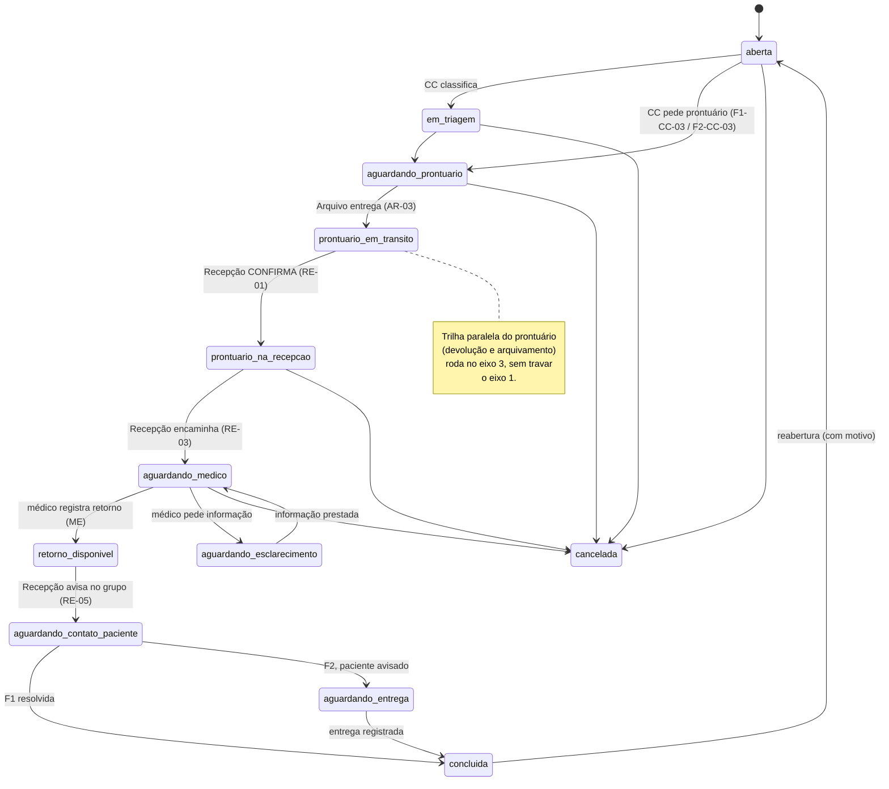

# 3. Os dois fluxos e a máquina de estados

## 3.0 Fidelidade aos fluxogramas — leia antes

**[FATO]** Os arquivos dos fluxogramas **não estão no repositório**. Procurei por `*flux*`, `*fluxo*`, `*call*` e em `docs/assets/`: não há nada.

Tudo o que está abaixo foi derivado **do texto do pedido**, etapa por etapa, sem suprimir, reordenar ou fundir etapas. Nenhuma etapa foi criada por conta própria; onde o texto não diz, está marcado **[PENDENTE]** em vez de preenchido por suposição.

> ⚠️ **Esta especificação precisa de uma conferência contra os fluxogramas originais antes de virar código.** Peço os dois arquivos (imagem, PDF ou `.drawio`) para: (a) confirmar a ordem das raias; (b) confirmar se há ramificações ou retornos que o texto não descreve; (c) conferir a numeração. Até isso acontecer, considere o capítulo 3 como **proposta fiel ao texto**, não como fidelidade verificada ao desenho.

**Sobre a numeração:** o pedido avisa que *os números são reutilizados em diferentes raias*. Por isso **não uso o número como identificador**. Cada atividade recebe um código próprio no formato `F1-CC-03` = Fluxo 1, raia Call Center, terceira atividade **daquela raia**. O número original do fluxograma aparece em coluna separada, só como referência.

---

## 3.1 Participantes e raias

| Raia | Código | Quem é | Tem conta no sistema |
|---|---|---|---|
| Paciente | `PA` | Pessoa atendida pela clínica | **Não** |
| Call Center | `CC` | Atendentes que recebem a ligação ou mensagem | Sim |
| Arquivo (Silvio) | `AR` | Responsável pelo arquivo de prontuários | Sim |
| Recepção | `RE` | Recebe prontuário, confere, leva ao médico, recebe retorno | Sim |
| Médico | `ME` | Analisa e decide. **Decisão clínica é exclusiva dele** | Sim |

---

## 3.2 Fluxo 1 — Dúvida ou correção na receita

### Trilha principal

| Código | Nº orig. | Raia | Atividade | O que o sistema faz | Estado resultante |
|---|---|---|---|---|---|
| `F1-PA-01` | 1 | Paciente | Percebe algo errado, incompleto ou que precisa de esclarecimento na receita | **Nada.** Acontece fora do sistema. O Call Center registra depois | — |
| `F1-PA-02` | 2 | Paciente | Liga ou manda mensagem informando o problema | Nada (fora do sistema) | — |
| `F1-CC-01` | 2 | Call Center | Identifica o paciente e inicia o registro | Busca/cadastra paciente | — |
| `F1-CC-02` | 3 | Call Center | **Registra o ocorrido**: relato, tipo de problema, identificação e informações disponíveis | Cria `solicitacoes` com `tipo = duvida_correcao`, gera protocolo, grava autor | `aberta` |
| `F1-CC-03` | 4 | Call Center | **Envia o caso ao Arquivo** — comunica no grupo operacional do WhatsApp | Registra `comunicacoes` (canal `whatsapp_grupo`, tipo `pedido_prontuario`) e cria a tarefa de localizar. **O sistema não envia a mensagem** | `aguardando_prontuario` |
| `F1-AR-01` | 5 | Arquivo | Consulta o pedido no grupo e **localiza** o prontuário | Movimento `localizado` | `aguardando_prontuario` |
| `F1-AR-02` | 5 | Arquivo | **Separa / retira** o prontuário para encaminhamento | Movimento `retirado`; custódia passa a ser o Arquivo | `aguardando_prontuario` |
| `F1-AR-03` | 6 | Arquivo | **Leva o papel e o prontuário físico até a Recepção** | Movimento `entregue` → custódia *em trânsito*. **Não marca como concluído** | `prontuario_em_transito` |
| `F1-RE-01` | 7 | Recepção | **Recebe** o papel e o prontuário | Movimento `recebido` — **confirmação de quem recebe**; custódia passa à Recepção | `prontuario_na_recepcao` |
| `F1-RE-02` | 7 | Recepção | **Confere** as informações e consulta o grupo para entender o motivo | Registra `conferido`; pode abrir pendência de divergência | `prontuario_na_recepcao` |
| `F1-RE-03` | 8 | Recepção | **Apresenta o caso ao médico** | Registra encaminhamento; o médico passa a ver o caso na fila dele | `aguardando_medico` |
| `F1-ME-01` | 9 | Médico | **Analisa** o prontuário e **resolve ou analisa a correção** | Cria `avaliacoes_medicas` com o desfecho: `respondido`, `corrigido`, `precisa_esclarecimento`. Se houve correção, cria nova **versão** do documento | `retorno_disponivel` ou `aguardando_esclarecimento` |
| `F1-RE-04` | 10 | Recepção | **Recebe a resposta** do médico e registra que está disponível para encaminhamento | Marca o retorno como recebido pela Recepção | `retorno_disponivel` |
| `F1-RE-05` | 11 | Recepção | **Avisa no grupo** para o Call Center ter acesso à resposta | Registra `comunicacoes` (canal `whatsapp_grupo`, tipo `aviso_retorno`) com resultado | `aguardando_contato_paciente` |
| `F1-CC-04` | 12 | Call Center | **Confere a resposta** no grupo e registra a informação necessária | Registra conferência, vinculada à solicitação original | `aguardando_contato_paciente` |
| `F1-CC-05` | 13 | Call Center | **Retorna ao paciente** e comunica a resposta do médico | Registra `comunicacoes` (canal e **resultado**: falou / não atendeu / número errado / recado). Tentativa **não** é confirmação | `aguardando_contato_paciente` até haver contato efetivo |
| `F1-CC-06` | 14 | Call Center | **Caso resolvido** — dúvida esclarecida | Encerra com `desfecho = resolvida`, **se** os requisitos de conclusão estiverem cumpridos | `concluida` |

**Ramificações explícitas do texto:**

- `F1-ME-01` → se o médico precisa de esclarecimento, a solicitação vai para `aguardando_esclarecimento` e volta ao Call Center ou à Recepção, **sem encerrar**.
- `F1-CC-05` → se a resposta exige **nova ação**, a solicitação **permanece aberta** ou é encaminhada para a etapa apropriada (texto da etapa 14). Não encerra.

### Trilha paralela — devolução do prontuário (Fluxo 1)

Roda **ao mesmo tempo** que a comunicação com o paciente. Controle próprio, nunca confundido com o desfecho do atendimento.

| Código | Raia | Atividade | O que o sistema faz |
|---|---|---|---|
| `F1-RE-P1` | Recepção | **Devolve** o prontuário ao Arquivo | Movimento `devolvido` → custódia *em trânsito de volta* |
| `F1-AR-P1` | Arquivo | **Recebe** o prontuário | Movimento `recebido_devolucao`; custódia volta ao Arquivo |
| `F1-AR-P2` | Arquivo | **Arquiva** no local apropriado | Movimento `arquivado`; registra o local. Fim da trilha física |

**Regras desta trilha** (todas vindas do texto):

1. A devolução e o arquivamento são **controlados independentemente** do contato com o paciente.
2. O atendimento **não fica indefinidamente sem conclusão** só porque existe etapa administrativa pendente — mas
3. a pendência **continua visível** (fila do Arquivo + indicador do dashboard), e
4. **[PENDENTE]** a política final — se o encerramento espera o arquivamento ou não — **será confirmada com a empresa** (item 12.2). Até lá, o sistema é construído com a trava **configurável**, padrão "não espera, mas mostra a pendência".

### Resultado esperado do Fluxo 1

Solicitação registrada · prontuário localizado e movimentado · caso apresentado ao médico · resposta registrada · retorno comunicado ao paciente · prontuário devolvido e arquivado · histórico completo das ações e dos responsáveis.

> **Este fluxo não é pedido de nova receita.** Nenhuma tela, filtro ou relatório deve misturar os dois tipos.

---

## 3.3 Fluxo 2 — Solicitação de receita médica

### Trilha principal

| Código | Nº orig. | Raia | Atividade | O que o sistema faz | Estado resultante |
|---|---|---|---|---|---|
| `F2-PA-01` | 1 | Paciente | Identifica a necessidade de uma nova receita | Nada (fora do sistema) | — |
| `F2-PA-02` | 2 | Paciente | Liga ou manda mensagem solicitando a receita | Nada | — |
| `F2-CC-01` | 2 | Call Center | Identifica o paciente e inicia o registro | Busca/cadastra paciente | — |
| `F2-CC-02` | 3 | Call Center | **Anota o pedido**: dados da solicitação, paciente e o necessário para a equipe seguir | Cria `solicitacoes` com `tipo = pedido_receita`, gera protocolo | `aberta` |
| `F2-CC-03` | 4 | Call Center | **Avisa o Arquivo** no grupo: é preciso localizar o prontuário | Registra `comunicacoes` + tarefa de localizar | `aguardando_prontuario` |
| `F2-AR-01` | 5 | Arquivo | Consulta o pedido no grupo e **procura** o prontuário | Movimento `localizado` | `aguardando_prontuario` |
| `F2-AR-02` | 5 | Arquivo | **Retira** o prontuário | Movimento `retirado` | `aguardando_prontuario` |
| `F2-AR-03` | 6 | Arquivo | **Leva o prontuário à Recepção** | Movimento `entregue` → *em trânsito* | `prontuario_em_transito` |
| `F2-RE-01` | 7 | Recepção | **Recebe** o prontuário | Movimento `recebido` (confirmação) | `prontuario_na_recepcao` |
| `F2-RE-02` | 7 | Recepção | **Confere** o prontuário e verifica o pedido de receita do paciente | Registra `conferido`. **Se houver divergência de identificação ou informação insuficiente, encaminha para correção e não prossegue** | `prontuario_na_recepcao` ou `divergencia` |
| `F2-RE-03` | 8 | Recepção | **Leva o caso ao médico** (prontuário + pedido) | Registra encaminhamento | `aguardando_medico` |
| `F2-ME-01` | 9 | Médico | **Analisa** prontuário e pedido | — | `aguardando_medico` |
| `F2-ME-02` | 9 | Médico | **Emite a receita** quando considerar apropriado, conforme sua avaliação e as normas aplicáveis | Cria `avaliacoes_medicas` com desfecho `receita_emitida` + `documentos` (`tipo = receita`) com referência segura | `retorno_disponivel` |
| `F2-ME-02b` | 9 | Médico | **Ou** não aprova / precisa de mais informação | Desfecho `nao_aprovado` ou `precisa_esclarecimento`; **pendência encaminhada**, não encerra sozinho | `aguardando_esclarecimento` ou `concluida (nao_aprovada)` |
| `F2-RE-04` | 10 | Recepção | **Recebe a receita** pronta e registra que o documento está disponível | Marca o documento como disponível na Recepção | `retorno_disponivel` |
| `F2-RE-05` | 11 | Recepção | **Avisa no grupo** que a receita está pronta | Registra `comunicacoes`; a mensagem **referencia o protocolo** para o Call Center identificar a qual solicitação pertence | `aguardando_contato_paciente` |
| `F2-CC-04` | 12 | Call Center | **Confere o aviso** no grupo e confirma que a receita está pronta | Registra o recebimento da informação; a próxima ação fica explícita | `aguardando_contato_paciente` |
| `F2-CC-05` | 13 | Call Center | **Avisa o paciente** que a receita está pronta | Registra `comunicacoes` com resultado | ramifica abaixo |

### Ramificação da etapa 13 — como a receita chega ao paciente

| Código | Opção | Atividade | O que o sistema faz | Estado da entrega |
|---|---|---|---|---|
| `F2-CC-13A1` | **A — física** | Paciente é informado de que precisa **retirar na clínica** | Cria `entregas` com `modo = fisica`, registra `orientada` | `orientada` |
| `F2-CC-13A2` | A | **Retirada efetiva** | Registro próprio, por quem entrega. **O sistema não marca como entregue antes dessa confirmação** | `retirada_confirmada` |
| `F2-CC-13B1` | **B — digital** | Call Center informa que a receita será enviada digitalmente | Cria `entregas` com `modo = digital`, registra `anunciada` | `anunciada` |
| `F2-CC-13B2` | B | Documento é **encaminhado por canal autorizado**, com validação do destinatário | Registra `tentativa_envio` com canal e destinatário autorizado | `envio_tentado` |
| `F2-CC-13B3` | B | Call Center registra o resultado conforme a **confirmação disponível** | `enviado` / `falhou`. **Tentativa não é confirmação de entrega nem de leitura** | `enviado` / `falha` |

> **[PENDENTE]** `F2-CC-13A2` — o texto diz *"caso faça parte do escopo operacional confirmado"*. Se a retirada é registrada na Recepção, essa raia precisa de um terminal. Item 12.14.

### Trilha paralela — devolução do prontuário (Fluxo 2)

Idêntica à do Fluxo 1, e igualmente **paralela ao aviso ao paciente**: `F2-RE-P1` devolve → `F2-AR-P1` recebe → `F2-AR-P2` arquiva. Registrada **independentemente da entrega da receita**.

### Resultado esperado do Fluxo 2

Pedido registrado · prontuário localizado e encaminhado · solicitação analisada pelo médico · receita emitida quando apropriado · Call Center informado · paciente avisado · entrega física ou digital registrada **conforme o resultado real** · prontuário devolvido e arquivado.

---

## 3.4 Máquina de estados

### Princípio: seis eixos de estado, não um campo de status

O pedido é explícito: *"Não use um único campo de status para representar todo o processo."* Os eixos são independentes e avançam em ritmos diferentes.

| # | Eixo | Onde vive | Valores |
|---|---|---|---|
| 1 | **Solicitação** | `solicitacoes.etapa` | `aberta` · `em_triagem` · `aguardando_prontuario` · `prontuario_em_transito` · `prontuario_na_recepcao` · `aguardando_medico` · `aguardando_esclarecimento` · `retorno_disponivel` · `aguardando_contato_paciente` · `aguardando_entrega` · `concluida` · `cancelada` |
| 2 | **Tarefa** | `solicitacao_tarefas.estado` | `pendente` · `em_andamento` · `concluida` · `cancelada` |
| 3 | **Prontuário (custódia)** | `prontuarios.local` + `prontuario_movimentos` | `arquivo` · `em_transito_para_recepcao` · `recepcao` · `com_medico` · `em_transito_para_arquivo` · `nao_localizado` |
| 4 | **Documento** | `documentos.estado` | `rascunho` · `emitido` · `substituido` |
| 5 | **Comunicação** | `comunicacoes.resultado` | `registrada` · `sem_resposta` · `falou` · `nao_atendeu` · `numero_invalido` · `recado` · `falhou` |
| 6 | **Entrega** | `entregas.estado` | `nao_aplicavel` · `orientada` · `anunciada` · `envio_tentado` · `enviado` · `retirada_confirmada` · `falha` |

**Por que `aguardando_entrega` é etapa principal só no Fluxo 2:** no Fluxo 1 não há documento a entregar — o desfecho é a resposta comunicada. Para o Fluxo 1 a etapa **não existe**, e isso é validado no banco.

**Por que a devolução do prontuário NÃO é etapa principal:** porque é paralela. Ela vive **só** no eixo 3. Colocá-la no eixo 1 obrigaria o atendimento a esperar o arquivamento — exatamente o que o pedido proíbe confundir.

### Diagrama do eixo 1

### Tabela de transições do eixo 1

Para cada transição: origem, destino, papel autorizado, condições obrigatórias, dados necessários, efeitos colaterais, auditoria e comportamento em caso de falha.

Convenção comum a todas: **auditoria** = linha em `solicitacao_eventos` (ator, horário, de → para, motivo) + linha em `atividades` via trigger; **falha** = transação revertida, nada parcialmente aplicado, mensagem segura via `mensagemErro()`, estado inalterado. Repetição da mesma transição é **idempotente** (retorna sucesso sem segundo efeito).

| T | De → Para | Papel | Condições | Dados | Efeitos |
|---|---|---|---|---|---|
| T01 | *(nova)* → `aberta` | Call Center | paciente identificado; tipo definido | tipo, paciente, relato | gera protocolo; cria tarefa inicial; avisa duplicidade provável |
| T02 | `aberta` → `em_triagem` | Call Center | — | classificação | opcional; **[PENDENTE]** se a triagem é etapa real (item 12.10) |
| T03 | `aberta` \| `em_triagem` → `aguardando_prontuario` | Call Center | prontuário do paciente identificável | referência do prontuário, comunicação ao grupo | cria tarefa `localizar_prontuario` para o Arquivo; registra `comunicacoes` |
| T04 | `aguardando_prontuario` → `prontuario_em_transito` | Arquivo | prontuário `localizado` **e** `retirado` | movimento `entregue`, destino Recepção | custódia → `em_transito_para_recepcao`; cria tarefa `confirmar_recebimento` para a Recepção |
| T05 | `prontuario_em_transito` → `prontuario_na_recepcao` | **Recepção** | existe movimento `entregue` em aberto | confirmação, horário | custódia → `recepcao`; **só a Recepção pode** — o Arquivo não confirma o próprio recebimento (regra 9) |
| T06 | `prontuario_na_recepcao` → `aguardando_medico` | Recepção | `conferido` registrado; sem divergência aberta | médico destinatário | cria tarefa `avaliar` para o médico; custódia → `com_medico` |
| T07 | `aguardando_medico` → `retorno_disponivel` | **Médico** (permissão clínica) | solicitação encaminhada a ele | desfecho da avaliação; documento quando houver | cria `avaliacoes_medicas`; F2 com receita cria `documentos` e `entregas`; cria tarefa `receber_retorno` para a Recepção |
| T08 | `aguardando_medico` → `aguardando_esclarecimento` | Médico | — | o que falta | cria tarefa de esclarecimento para CC ou Recepção; **não encerra** |
| T09 | `aguardando_esclarecimento` → `aguardando_medico` | CC / Recepção | informação registrada | — | reabre a tarefa do médico |
| T10 | `retorno_disponivel` → `aguardando_contato_paciente` | Recepção | retorno recebido pela Recepção | comunicação ao grupo com protocolo | cria tarefa `contatar_paciente` para o Call Center |
| T11 | `aguardando_contato_paciente` → `concluida` | Call Center | **tipo = F1**; contato com resultado efetivo; nenhuma pendência obrigatória aberta | desfecho | encerra; pendência de arquivamento **continua visível** |
| T12 | `aguardando_contato_paciente` → `aguardando_entrega` | Call Center | **tipo = F2**; paciente avisado | modo de entrega (física/digital) | cria `entregas` no modo escolhido |
| T13 | `aguardando_entrega` → `concluida` | Call Center / Recepção | entrega em estado terminal real (`retirada_confirmada`, `enviado`) — **nunca** `envio_tentado` | — | encerra |
| T14 | `aguardando_medico` → `concluida` (`nao_aprovada`) | Médico | tipo = F2; decisão de não aprovar registrada | motivo | pendência de comunicação ao paciente permanece como tarefa |
| T15 | qualquer não terminal → `cancelada` | Call Center ou admin da empresa | motivo obrigatório | motivo | **preserva todo o histórico**; se há prontuário fora do arquivo, abre pendência de devolução |
| T16 | `concluida` → `aberta` (reabertura) | Call Center ou admin da empresa | motivo obrigatório | motivo | **nada do histórico é apagado**; incrementa contador de reaberturas (métrica de retrabalho) |

### Transições do eixo 3 (custódia do prontuário)

| T | De → Para | Papel | Condição |
|---|---|---|---|
| C01 | `arquivo` → `arquivo` (`localizado`) | Arquivo | solicitação em `aguardando_prontuario` |
| C02 | `arquivo` → `arquivo` (`retirado`) | Arquivo | `localizado` registrado |
| C03 | `arquivo` → `em_transito_para_recepcao` | Arquivo | `retirado` registrado |
| C04 | `em_transito_para_recepcao` → `recepcao` | **Recepção** | existe entrega em aberto |
| C05 | `recepcao` → `com_medico` | Recepção | encaminhamento registrado |
| C06 | `com_medico` → `recepcao` | Recepção | retorno recebido |
| C07 | `recepcao` → `em_transito_para_arquivo` | Recepção | — (**independe** do eixo 1) |
| C08 | `em_transito_para_arquivo` → `arquivo` (`recebido_devolucao`) | **Arquivo** | existe devolução em aberto |
| C09 | `arquivo` → `arquivo` (`arquivado`) | Arquivo | `recebido_devolucao` registrado; local informado |
| C10 | qualquer → `nao_localizado` | Arquivo | prontuário não encontrado; abre pendência e avisa o Call Center |

**Invariante:** um prontuário tem **uma** custódia por vez. Duas movimentações incompatíveis simultâneas são impedidas por `select ... for update` na linha do prontuário dentro da função de transição (regra 8, RNF-11).
