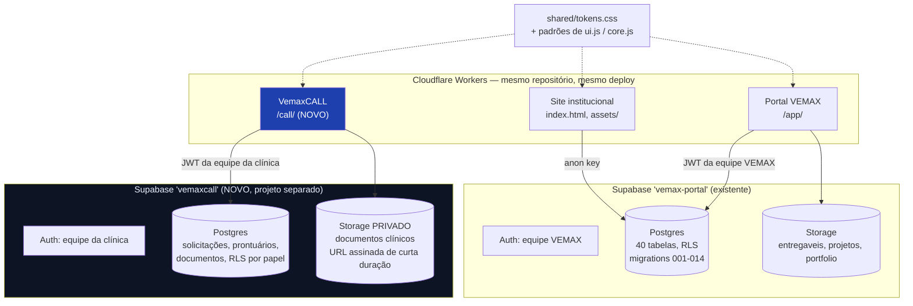
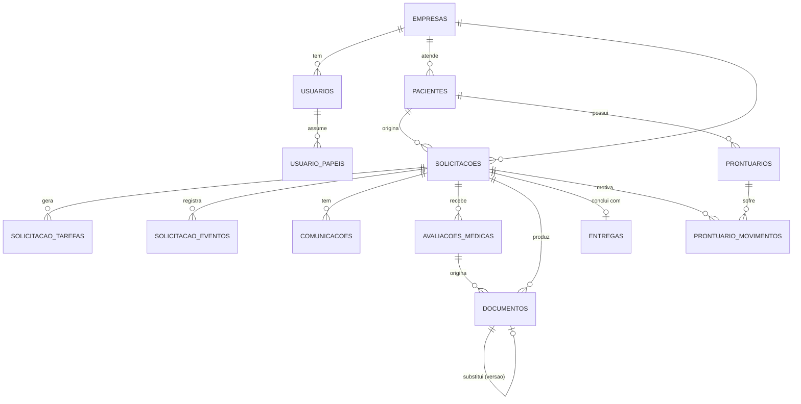

# 7. Modelo de domínio, dados e arquitetura

## 7.1 Arquitetura proposta



**O que é reaproveitado** (sem copiar e colar cego, sem alterar o original):

| Do portal | Como entra no VemaxCALL |
|---|---|
| `shared/tokens.css` | **importado como está.** Identidade visual idêntica, zero duplicação |
| `app/js/ui.js` — `h()`, `modal()`, `formModal()`, `toast()`, `run()`, `pageHead()`, `tabs()`, `empty()` | **extrair para `shared/js/ui.js`** e passar os dois a consumir. O `NAV` e o `start()` ficam específicos de cada área |
| `app/js/core.js` — `dataTable()`, `kanban()`, `filtros()`, `timeline()`, `badge()` | mesma extração. `timeline()` precisa de parâmetro de tabela (hoje é fixa em `interacoes`) |
| `app/js/validacao.js` | **importado como está.** Já é puro e testado |
| `app/js/boot.js` | padrão copiado (`data-modulo`/`data-fn`): mantém a CSP sem `unsafe-inline` |
| `app/js/sessao.js` | importado; o VemaxCALL passa limites próprios (15 min / 8 h) |
| Padrão de `auth.js` | reescrito como `call/js/auth.js`: mesmo desenho (`sessao_valida`, 2FA), papéis diferentes |
| `tests/integration/banco.mjs` | parametrizar a pasta de migrations; o resto serve inteiro |
| `scripts/verificar.mjs` | estender a varredura para `call/` |

**[RECOMENDAÇÃO]** A extração para `shared/js/` é a única mudança que toca o portal existente. É mecânica (mover arquivo + ajustar import), coberta por `telas.mjs`, e evita a pior alternativa: duas cópias de `ui.js` divergindo com o tempo. **Fazer isso como primeiro commit da Fase A, isolado, com os testes do portal passando antes e depois.**

## 7.2 Modelo de domínio



### Tabelas propostas

Nomes com prefixo `call_` para conviver sem ambiguidade caso o ADR-001 seja decidido a favor da base compartilhada.

| Tabela | Papel | Observações de projeto |
|---|---|---|
| `call_empresas` | A empresa atendida | Existe mesmo na base separada: permite uma segunda clínica depois sem remodelar. Uma linha hoje |
| `call_profiles` | Usuário da clínica | Espelha `auth.users`; `registro_profissional` **obrigatório quando** tem papel `medico` |
| `call_usuario_papeis` | Papéis do usuário | N:N; ver `06-papeis-permissoes.md` |
| `call_papeis_permissoes` | Matriz papel × recurso × ação | Dado, não código; **só por migration** |
| `call_pacientes` | Paciente | **Minimização:** nome, documento, nascimento, telefone, e-mail, observação de identificação. **Nada clínico** |
| `call_prontuarios` | O prontuário físico | `codigo`, `paciente_id`, `local` (custódia atual), `custodia_usuario_id`, `local_arquivo` |
| `call_prontuario_movimentos` | Histórico de custódia | **Append-only.** RLS sem UPDATE nem DELETE |
| `call_solicitacoes` | Centro do sistema | `protocolo`, `tipo`, `etapa`, `etapa_desde`, `desfecho`, `prioridade`, `paciente_id`, `prontuario_id`, `responsavel_id`, `aberta_por`, `concluida_em`, `reaberturas` |
| `call_solicitacao_tarefas` | O que falta fazer, por papel | `papel_responsavel`, `responsavel_id`, `estado`, `prazo` — permite tarefas **paralelas** |
| `call_solicitacao_eventos` | Linha do tempo imutável | `de_etapa`, `para_etapa`, `ator`, `motivo`. **Append-only** |
| `call_avaliacoes_medicas` | Retorno do médico | `desfecho`, `conteudo_clinico`, `resumo_para_paciente`, `medico_id`, `registro_profissional` (cópia no momento do registro) |
| `call_documentos` | Receita e documentos | `tipo`, `versao`, `substitui_id`, `estado`, `caminho_storage`, `hash`. **Nunca sobrescreve** |
| `call_comunicacoes` | Toda comunicação | `canal`, `tipo`, `destinatario_tipo`, `resultado`, `tentativa_de_id` (para reenvio) |
| `call_entregas` | Como a receita chegou | `modo`, `estado`, timestamps por estado. 0 ou 1 por solicitação |
| `call_pendencias` | Pendências visíveis | **[RECOMENDAÇÃO]** view materializada, não tabela: pendência é derivada do estado, e tabela separada sai de sincronia |
| `call_config` | Metas, prazos, rótulos, política de encerramento | Editável pelo `admin_empresa`, exceto a trava de política |
| `call_auditoria` | Acesso a dado clínico | **Além** do `atividades` de mudanças: registra **leitura** de avaliação e download de documento (item 11 do pedido) |

### Chaves, restrições e índices

```sql
-- Padrão: igual ao do portal (uuid + número legível), ver 01-auditoria.md 1.4
create table call_solicitacoes (
  id          uuid primary key default gen_random_uuid(),
  empresa_id  uuid not null references call_empresas(id),
  protocolo   bigint generated always as identity,
  tipo        text not null check (tipo in ('duvida_correcao','pedido_receita')),
  etapa       text not null default 'aberta',
  etapa_desde timestamptz not null default now(),
  desfecho    text check (desfecho is null or desfecho in ('resolvida','nao_aprovada','cancelada','sem_contato')),
  paciente_id uuid not null references call_pacientes(id),
  -- ... demais colunas
  concluida_em timestamptz,
  reaberturas  int not null default 0,
  unique (empresa_id, protocolo),
  -- integridade de estado: concluída exige desfecho e data; aberta não tem nenhum dos dois
  check ((etapa in ('concluida','cancelada')) = (desfecho is not null)),
  check ((etapa = 'concluida') = (concluida_em is not null)),
  -- RN-22: entrega só existe no fluxo 2 -> validado na tabela call_entregas
  check (etapa <> 'aguardando_entrega' or tipo = 'pedido_receita')
);

create index on call_solicitacoes (empresa_id, etapa) where etapa not in ('concluida','cancelada');
create index on call_solicitacoes (empresa_id, responsavel_id, etapa);
create index on call_solicitacoes (paciente_id, criado_em desc);
create index on call_solicitacao_tarefas (papel_responsavel, estado) where estado in ('pendente','em_andamento');
create index on call_prontuario_movimentos (prontuario_id, criado_em desc);
create index on call_prontuarios (empresa_id, local) where local <> 'arquivo';   -- pendências de devolução
```

**Integridade referencial:** nenhum `on delete cascade` em tabela de histórico. Prontuário e paciente usam `on delete restrict` — registro clínico não desaparece por engano. Exclusão de solicitação é **recuperável** (`deleted_at`), igual ao portal.

**Transações:** toda transição é uma função `security definer` que (1) checa `can_call()`, (2) faz `select ... for update` na solicitação **e** no prontuário quando a transição toca custódia, (3) valida contra `call_transicoes_validas`, (4) aplica, (5) grava evento. Tudo ou nada — o padrão já usado em `projeto_de_proposta()`.

**Retenção:** **[PENDENTE]** item 12.3. Fatos relevantes: prontuário médico tem guarda mínima de **20 anos** pela Resolução CFM 1.821/2007, e o VemaxCALL guarda **metadados de movimentação**, não o prontuário em si — o prazo aplicável aos registros de atendimento precisa de definição jurídica. Até lá, nenhum descarte automático é implementado.

## 7.3 Decisão sobre o banco atual

**[FATO]** O banco atual (Postgres 17 gerenciado, RLS, triggers) é **tecnicamente adequado** para o VemaxCALL: relacional, com transações, CHECK, RLS, e já com os padrões que o módulo precisa.

**[RECOMENDAÇÃO]** Não há migração de dados. O VemaxCALL é **aditivo**: tabelas novas, nenhuma tabela existente alterada, nenhum dado movido. Isso elimina o risco da seção 7 do pedido (riscos de migração, compatibilidade, reversão) para o próprio dado.

A única mudança no existente é a extração de `shared/js/`, que é **código, não dado**:

| Risco | Mitigação | Reversão |
|---|---|---|
| Import quebrado no portal | `npm run check` verifica todo import relativo; `telas.mjs` renderiza as 21 telas | `git revert` do commit de extração — é um commit só |
| Divergência de comportamento | nenhuma linha de lógica muda; só o caminho do arquivo | idem |

**Plano de reversão geral do VemaxCALL:** como nada existente é alterado, desligar o módulo é remover a linha de `NAV`/rota e parar de servir `/call/`. As tabelas `call_*` ficam intactas (ou o projeto Supabase separado é pausado). Nenhum efeito sobre site ou portal.
