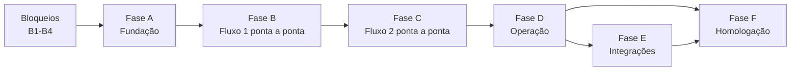

# 11. Backlog priorizado e plano de implementação

## 11.0 Antes de começar — bloqueios reais

Nada da Fase A deve começar antes destes quatro itens — **com uma exceção**: os itens **A1 e A7** (extração de `shared/js/` e parametrização do harness de teste) não dependem de nenhuma resposta, servem ao portal tanto quanto ao VemaxCALL e **já foram executados**.

| # | Bloqueio | Por quê |
|---|---|---|
| B1 | **Receber os dois fluxogramas** e conferir contra `03-fluxos.md` | a especificação foi derivada do texto; a fidelidade ao desenho **não está verificada** |
| B2 | **Respostas às perguntas 12.1 a 12.7** | definem papéis LGPD, política de encerramento, acesso clínico do Call Center e forma da receita |
| B3 | **Decisão do ADR-001** (base separada × compartilhada) | muda tudo: infraestrutura, Auth, CSP, custo |
| B4 | **Validação da matriz 6.3 pelos próprios papéis** | em especial a linha "Call Center não lê conteúdo clínico" |

**[RECOMENDAÇÃO]** B1 e B4 resolvem-se numa reunião de uma hora com os quatro papéis e os fluxogramas projetados. É o maior ganho de risco por tempo investido em todo o projeto.

## 11.1 Ordem e dependências

Regra do pedido, respeitada: **concluir e validar cada fase antes de expandir**. A Fase B entrega um fluxo que funciona de verdade, não meio sistema.

## 11.2 Fase A — Fundação

| # | Entrega | Depende de | Observação |
|---|---|---|---|
| A1 | ✅ **feito** — `shared/js/` com `dom.js`, `tabela.js`, `formato.js`, `validacao.js` e `sessao.js`; portal apontado para lá | — | commit `76329a7` (branch `refactor/shared-js`), isolado. Detalhes em `07-modelo-dados.md`, 7.1 |
| A2 | Projeto Supabase do VemaxCALL criado, região e backup configurados | B3 | ligar leaked password protection e MFA |
| A3 | Migration `call_001`: empresas, profiles, papéis, matriz de permissão, `can_call()`, `mfa_ok_call()` | A2, B4 | RLS padrão negar em tudo |
| A4 | Migration `call_002`: pacientes, prontuários, movimentos, solicitações, tarefas, eventos + índices | A3 | ADR-004 |
| A5 | Migration `call_003`: `call_transicoes_validas` + `mover_solicitacao()` + `mover_prontuario()` + `pode_concluir()` | A4 | TDD: testes antes |
| A6 | Migration `call_004`: auditoria de mudança e de **leitura** | A4 | `call_auditoria` |
| A7 | ✅ **feito** — `banco.mjs` aceita `{ migracoes }` (relativa à raiz ou absoluta) | A1 | commit `76329a7`. Habilita todos os testes seguintes com o harness PGlite |
| A8 | **`call-sql-permissoes.mjs`**: matriz completa papel × transição | A5, A7 | gate de qualidade da fase |
| A9 | **`call-sql-estados.mjs`**: T01–T16, C01–C10, válidas e inválidas | A5, A7 | idem |
| A10 | `call/login/` + `call/js/auth.js` (sessão 15 min / 8 h, 2FA obrigatório) | A3 | padrão de `app/js/auth.js` |
| A11 | Casca do VemaxCALL: `call/index.html`, `boot.js`, menu por papel, tokens.css | A1, A10 | identidade visual idêntica |
| A12 | `_headers` com bloco `/call/*`, CSP com o novo host, `robots.txt` | A2 | |
| A13 | `verificar.mjs` estendido para `call/` | A11 | |
| A14 | Doc de operação: como criar usuário, atribuir papel, aplicar migration | A3 | |

**Critério de saída da Fase A:** um usuário de cada papel entra, vê o menu certo, e **nenhuma** transição é possível pelo papel errado — provado por A8 e A9 rodando no CI.

## 11.3 Fase B — Fluxo 1 ponta a ponta

| # | Entrega | Depende de |
|---|---|---|
| B-01 | Cadastro e busca de paciente (minimizado) — RF-05, RF-06 | A |
| B-02 | Abrir solicitação `duvida_correcao` com protocolo e aviso de duplicidade — RF-01, RF-03, RF-04 | B-01 |
| B-03 | Pedir prontuário + registrar comunicação ao grupo (T03) — RF-31 | B-02 |
| B-04 | Fila do Arquivo: localizar, retirar, entregar (C01–C03) — RF-10 a RF-12 | B-03 |
| B-05 | Fila da Recepção: **confirmar recebimento** (C04) e conferir — RF-13, RF-14, **RN-21** | B-04 |
| B-06 | Encaminhar ao médico (T06) — RF-20 | B-05 |
| B-07 | Fila do médico: registrar retorno/correção com versionamento — RF-21 a RF-23, RN-11 | B-06 |
| B-08 | Recepção recebe o retorno e avisa no grupo (T10) — RF-25 | B-07 |
| B-09 | Call Center confere e contata o paciente com **resultado** — RF-32, RF-33, RN-12 | B-08 |
| B-10 | Concluir com `pode_concluir()` — RF-36, RN-06 | B-09 |
| B-11 | **Trilha paralela**: devolver, receber, arquivar — RF-15 a RF-17, **testada com a solicitação aberta e concluída** | B-05 |
| B-12 | Detalhe da solicitação: linha do tempo, tarefas, movimentações, comunicações, **próxima ação em destaque** — RF-42 | B-10 |
| B-13 | Central de solicitações com filtros, ordenação e paginação **no servidor** — RF-41, RNF-04 | B-12 |
| B-14 | Cancelar e reabrir preservando histórico — RF-37, RN-15 | B-10 |
| B-15 | `call-telas.mjs` para tudo acima | B-13 |

**Critério de saída:** o Fluxo 1 roda inteiro, na ordem do fluxograma, cada etapa pelo papel certo, e a devolução do prontuário funciona independentemente.

## 11.4 Fase C — Fluxo 2 ponta a ponta

| # | Entrega | Depende de |
|---|---|---|
| C-01 | Abrir solicitação `pedido_receita` — RF-02 | B |
| C-02 | Conferência da Recepção com **divergência que interrompe** — RN-26 | B-05 |
| C-03 | Médico emite receita → `documentos` + `entregas` — RF-21, RN-11 | B-07 |
| C-04 | Médico **não aprova** ou pede informação, com pendência encaminhada — RF-24, RN-23 | C-03 |
| C-05 | Storage privado + URL assinada com TTL curto e auditoria — ADR-005, RNF-15, RN-18 | C-03 |
| C-06 | Versionamento de documento corrigido — RF-23, RN-15 | C-05 |
| C-07 | Recepção recebe a receita e avisa no grupo **com protocolo** — RF-25, RN-25 | C-03 |
| C-08 | **Entrega física**: orientar + confirmar retirada (separados) — RF-34, RN-14 | C-07 |
| C-09 | **Entrega digital**: anunciar, tentar, resultado — RF-35, **RN-13** | C-07 |
| C-10 | `pode_concluir()` do F2: não aceita `envio_tentado` | C-08, C-09 |
| C-11 | Trilha paralela de devolução no F2 | B-11 |

**Critério de saída:** F2 inteiro, incluindo o caminho sem receita, e **impossível** marcar entregue sem confirmação real.

## 11.5 Fase D — Operação

| # | Entrega | Observação |
|---|---|---|
| D-01 | **Filas de trabalho por papel** (item 6.5, as quatro listas de cada papel) — RF-43 | o que a equipe mais vai usar |
| D-02 | Dashboard operacional com as definições de contagem de 4.2 — RF-40 | **sem** "atrasadas" até existirem metas (12.11) |
| D-03 | Gestão de prontuários: tela própria com custódia e histórico — item 6.6 | |
| D-04 | Central de comunicações com texto pronto para copiar (protocolo incluído) | ADR-006 |
| D-05 | Relatórios do item 6.9, agregados, sem dado clínico — RF-44 | exportação CSV com `csvCell()` (já protege contra injeção de fórmula) |
| D-06 | Configurações da empresa: rótulos e metas de prazo | habilita "atrasadas" |
| D-07 | Indicadores visuais de pendência e atraso | |
| D-08 | Busca global e atalhos | padrão de `app/js/busca.js` |
| D-09 | Revisão de acessibilidade e de uso no celular — RNF-05, RNF-06 | |
| D-10 | Teste de carga com 10 mil solicitações — RNF-03 | |

## 11.6 Fase E — Integrações (só com definição prévia)

| # | Entrega | Pré-requisito |
|---|---|---|
| E-01 | Aviso por e-mail de pendência | Edge Function + SMTP; padrão de `notificar-email` |
| E-02 | WhatsApp oficial — **se viável** | ADR-006: provedor definido **e** confirmação de que grupo é suportado |
| E-03 | Assinatura digital de receita | 12.6 respondido |
| E-04 | Integração com prontuário eletrônico da clínica | 12.8 respondido |

**Nada da Fase E é pressuposto.** Se E-02 não for viável, o registro manual permanece — e isso não é falha, é o que os fluxogramas descrevem hoje.

## 11.7 Fase F — Homologação

Conforme `10-plano-testes.md`, 10.5. Critério de aceite: nenhum caso reprovado, nenhum achado de segurança alto aberto, restauração de backup comprovada, **aceite por escrito dos quatro papéis**.

## 11.8 Critérios de homologação (item 20 do pedido)

O VemaxCALL está homologado quando, com os fluxogramas na mão:

1. Cada etapa de cada fluxo tem um registro correspondente no sistema, executado pelo papel da raia certa.
2. A devolução do prontuário é registrada **sem** depender do contato com o paciente, e vice-versa.
3. Nenhuma receita aparece como entregue sem confirmação real (física ou digital).
4. Nenhum papel consegue uma ação fora da matriz 6.3 — testado tentando.
5. Nenhum dado de outra organização é alcançável.
6. O histórico de uma solicitação cancelada e reaberta está completo.
7. Os números do dashboard conferem com consulta manual ao banco.
8. Restauração de backup foi ensaiada e cronometrada.
9. Os quatro papéis declaram, por escrito, que o sistema reproduz o processo que executam hoje.
10. O DPA com a clínica está assinado e a retenção está definida.

## 11.9 Esforço relativo

Sem estimativa em horas — não há dado histórico do time para calibrar. Peso relativo entre fases:

| Fase | Peso | Risco |
|---|---|---|
| A — Fundação | ●●●○○ | **alto** (decisões estruturais; A1 toca o portal) |
| B — Fluxo 1 | ●●●●○ | médio |
| C — Fluxo 2 | ●●●○○ | médio-alto (documentos e entrega) |
| D — Operação | ●●●○○ | baixo |
| E — Integrações | ●●○○○ | **alto** (depende de terceiros) |
| F — Homologação | ●●○○○ | médio |
